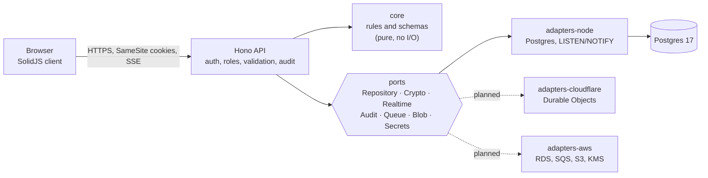

<div align="center">

<picture>
  <source media="(prefers-color-scheme: dark)" srcset="brand/logo-horizontal-reversed.svg">
  
</picture>

**Run a home health agency on software you own.**
See every caregiver and visit on one live screen, fill open shifts in a click, catch overtime and expiring credentials before they cost you, and keep patient data encrypted on your own servers.

[](LICENSE)
[](https://github.com/Srinivas26k/Hekara/actions/workflows/ci.yml)


[](CONTRIBUTING.md)
[](https://rzp.io/rzp/G5kLjzP)
[](COMMERCIAL.md)

[Why Hekara](#why-agencies-choose-hekara) · [Features](#what-you-get) · [Quick start](#quick-start) · [Security](#security-and-privacy) · [**Support the project**](#using-hekara-please-give-back) · [Enterprise](#enterprise-and-custom-builds) · [Contribute](#contributing)


**Free to use, free to self-host. If it saves your agency time or money, please [sponsor it](https://rzp.io/rzp/G5kLjzP) or [hire the maintainer](COMMERCIAL.md), including help with SOC 2 and HIPAA readiness, so it stays maintained.**

</div>

> **Status: alpha (v0.1).** Hekara runs end to end on Node and Postgres and is ready to evaluate, contribute to and build on. It has **not** been security-audited or certified, and it has no public hosted service. Read [Security and privacy](#security-and-privacy) before putting real patient data anywhere near it.

## Why agencies choose Hekara

Most small and mid-size agencies run on spreadsheets, group chats and phone calls, or pay per seat for software they cannot change or fully control. The cost shows up as late-found open shifts, overtime discovered after payroll, missed credential renewals, and callout phone tag.

| The everyday problem                | What Hekara does                                                                                        | What you gain                                                 |
| ----------------------------------- | ------------------------------------------------------------------------------------------------------- | ------------------------------------------------------------- |
| "Who is covering the 4 PM visit?"   | One live timeline of every caregiver and visit, updating in every open tab                              | Fewer calls and group chats; the whole team sees the same day |
| A caregiver calls out               | One-click **Fill** picks someone with the right skill, no overlap and room in their week, with **Undo** | Shifts covered in seconds, not an hour of phone calls         |
| Overtime discovered after payroll   | **Overtime watch** and Copilot suggestions to move visits before the limit                              | Lower overtime cost, fewer surprises                          |
| A CPR or TB test lapses unnoticed   | **Compliance** tracker buckets credentials into expired, 30 days, 90 days and valid                     | Audit-ready records, fewer lapsed credentials                 |
| "What changed, and who did it?"     | A tamper-evident **audit log** with an integrity check                                                  | Evidence for your own reviews and for auditors                |
| Patient data scattered across files | Encrypted patient records, care plans and notes in one place, with roles                                | Less exposure, and caregivers only see their own visits       |
| Per-seat fees and vendor lock-in    | Self-hosted, portable design, open source                                                               | You own your data and your costs, and can change the software |

## What you get

### Schedule smarter

- **Live day and week timeline** with a moving "now" marker, and statuses that follow the clock: done, in progress, scheduled, needs attention.
- **Open shifts** filled in one click, with Undo. Eligibility checks skill, overlap and the weekly limit.
- **AI Copilot:** explainable, rule-based suggestions to fill shifts and avoid overtime. They are re-checked on the server when applied, so stale suggestions are rejected. No patient data leaves your server.
- **Visits** list by day with status filters, and a caregiver filter on the timeline.

### Stay compliant and organised

- **Credentials:** track CPR, TB tests, background checks and more, with expiry buckets and an attention list.
- **Care plans:** per-patient plans with tasks, instructions, status and review dates, all encrypted, with overdue reviews flagged.
- **Patients and caregivers:** records, weekly load, skills, today's visits and the next visit.

### Run the business

- **Billing and claims:** claims move through a guarded workflow (draft, submitted, paid or denied).
- **Reports:** hours, fill rate, visits per day and claim totals over 7, 14 or 30 days, with a CSV export that neutralises spreadsheet formulas.
- **Overview:** today's visits by status, the week at a glance, what needs attention, and a billing snapshot for admins.

### Control who sees what

- **Four roles:** admin, scheduler, caregiver and billing, each limited to what they need. Caregivers see only their own visits, enforced on the server.
- **Invite-only accounts**, passkeys and authenticator-app codes, and an admin **activity log**.

### Your data, your infrastructure

- **Self-host** on a small server with Docker and Postgres. No per-seat fees and no vendor holding your data.
- **Portable by design:** the app talks to interfaces ("ports"), not a cloud, and every adapter must pass one shared contract test suite.
- **Light:** a client of about 50 KB gzipped, no Redis and no message broker.

<details>
<summary><b>More screenshots</b></summary>

|                                                |                                           |
| ---------------------------------------------- | ----------------------------------------- |
|           |  |
|  |  |
|             |          |

All screenshots use synthetic demo data. The profile photos are placeholder portraits from [randomuser.me](https://randomuser.me/photos) (hand-picked from the authorised section of [UI Faces](https://uifaces.co)); they are downloaded locally for demos and are **not** part of this repository. In your own deployment people show as initials until a photo is set.

</details>

### How it compares

|                                             | Spreadsheets and chat | Hosted per-seat software | **Hekara**                                                                            |
| ------------------------------------------- | --------------------- | ------------------------ | ------------------------------------------------------------------------------------- |
| Live shared view of the day                 | No                    | Yes                      | **Yes**                                                                               |
| One-click shift filling and overtime checks | No                    | Varies                   | **Yes**                                                                               |
| You own the data and where it runs          | Yes, but scattered    | No                       | **Yes**                                                                               |
| Cost grows with every user                  | No                    | Yes                      | **No**                                                                                |
| You can read, change and extend the code    | n/a                   | No                       | **Yes**                                                                               |
| Independent certifications                  | n/a                   | Often                    | **None yet** ([readiness help available](COMMERCIAL.md#compliance-and-risk-help-grc)) |
| Someone to call when it breaks              | No                    | Yes                      | **Community, or [paid support](COMMERCIAL.md)**                                       |

Hekara is not yet the right choice if you need certifications today or a vendor-run service with guaranteed support. For agencies that want control and are willing to self-host (or pay for help doing so), it is built for you.

## Using Hekara? Please give back

Hekara is **free**: you can use it, change it and self-host it without asking or paying. But free software is not free to make. It is built and maintained by one independent developer, and every bug fix, security patch, release and code review is time.

**Please don't just clone it and leave.** If Hekara is running part of your agency or your product, put a fair share back so it keeps getting better.

| You are                                | A fair way to give back                                                                                                                                                        |
| -------------------------------------- | ------------------------------------------------------------------------------------------------------------------------------------------------------------------------------ |
| **An agency or clinic running it**     | [Sponsor monthly](https://rzp.io/rzp/G5kLjzP), even a small amount, or [hire support](COMMERCIAL.md) for setup, hosting and training. It costs far less than per-seat software |
| **A company building a product on it** | Sponsor at a level that matches the value you get, fund a feature, or take a [commercial licence](COMMERCIAL.md) if the AGPL doesn't suit you                                  |
| **A developer**                        | Fix a bug, send a pull request, or take a paid [bounty](docs/FUNDING.md)                                                                                                       |
| **Anyone else**                        | Star the repo, share it with an agency that needs it, report what's broken                                                                                                     |

**[Sponsor Hekara](https://rzp.io/rzp/G5kLjzP)** · UPI, cards and net banking · any amount · [more details](https://srinivas26k.github.io/Hekara/)

### Where your support goes

- **Maintenance:** fixing bugs, reviewing contributions, keeping dependencies and security up to date.
- **Contributors:** 20% of sponsorship funds [bounties](docs/FUNDING.md) paid to developers who ship merged work.
- **Trust:** hosting for demos and, over time, an independent security review.

Sponsors are thanked here and in release notes unless they prefer to stay anonymous. _Be the first._

> Hekara is licensed under the AGPL-3.0, which gives you these freedoms and asks that network services built on a modified Hekara share their source. Paying is not a licence requirement; it is how an open-source project you depend on stays alive. For different terms, see [commercial licensing](COMMERCIAL.md).

## Quick start

You need **Node 24+**, **pnpm 12**, and **Docker** (for Postgres).

```sh
git clone https://github.com/Srinivas26k/Hekara.git
cd Hekara

cp .env.example .env
pnpm install

pnpm keygen                      # prints two DATA_KEYS lines: paste them into .env
openssl rand -base64 48          # paste the output as AUTH_SECRET in .env

docker compose up -d db          # Postgres on port 5442
pnpm db:migrate
DEMO_PASSWORD='choose-a-long-password' pnpm db:seed
pnpm demo:avatars                # optional: placeholder profile photos for the demo people

pnpm build && pnpm start         # http://localhost:3000
```

Sign in as `admin@juniper.test`, `scheduler@juniper.test`, `caregiver@juniper.test` or `billing@juniper.test` with the password you chose.

In development, add `?at=10:45` to the URL to freeze the clock and see the timeline at a fixed time.

```sh
pnpm typecheck       # strict TypeScript across every package
pnpm test            # unit, contract and integration tests (needs the database from docker compose)
pnpm dev             # server with reload
pnpm dev:client      # Vite dev server for the UI on :5173
```

## Security and privacy

What is built and tested today:

- **Field-level encryption** of patient names, dates of birth, addresses, notes, visit labels and care plans, with per-agency keys and rotation. Searching uses HMAC blind indexes, so plaintext is never indexed.
- **Tenant isolation:** every repository query is scoped by agency, and tests prove one agency cannot read, change or even detect another's data.
- **Deny-by-default roles**, checked on the server for every route.
- **Sessions:** 30 minutes idle, 12 hours absolute, `HttpOnly` `SameSite=Strict` cookies, exact-`Origin` checks on every write.
- **Sign-in protection:** Argon2id, per-address rate limits, and a per-account lockout that attackers cannot dodge by changing address. Failures return one uniform message.
- **Audit log:** append-only and hash-chained, with an admin integrity check and a daily verification job. Entries record who did what, never the patient data itself.
- **Browser hardening:** strict same-origin CSP with no inline script, no third-party requests, bundled fonts, and generated avatars.

What is **not** true yet, said plainly:

- Hekara has **not** had an independent security review or penetration test.
- Passkey sign-in is wired up but not covered by an automated test.
- Rate limiting and lockout are in memory, per server instance.
- There is no email service yet, so invite links are handed over by an admin.

### HIPAA and certifications

Software cannot be "HIPAA compliant" by itself. Compliance is a property of how an organisation operates: signed Business Associate Agreements with every vendor that touches patient data, risk assessments, policies, training and breach procedures. Hekara provides the technical safeguards (encryption, access control, audit trails, integrity checks) and [maps them to the rules](docs/HIPAA.md), but **Hekara itself holds no HIPAA, SOC 2, HITRUST or ISO 27001 certification.** I work in governance, risk and compliance (GRC) and cybersecurity, and can help you prepare for HIPAA, SOC 2 and similar programmes. If you need a deployment that supports them, see [Enterprise and custom builds](#enterprise-and-custom-builds).

## Architecture

Hekara follows **ports and adapters**. The domain and HTTP layers know nothing about where they run; platforms plug in through adapters, and every adapter must pass one shared contract test suite.



```text
apps/web                 Hono API + SolidJS client (one deployable)
packages/core            Domain types, Valibot schemas, scheduling and compliance rules (pure)
packages/ports           Interfaces every platform adapter implements
packages/crypto          AES-256-GCM field encryption, key rotation, blind indexes
packages/db              Drizzle schema and SQL migrations
packages/adapters-node   Postgres repository, hash-chained audit, LISTEN/NOTIFY realtime, Argon2id
packages/contract-tests  The suite every adapter must pass
docs/                    PRD, TRD, architecture, security, HIPAA notes, portability, ADRs
```

### Tech stack

| Layer      | Choice                                                                                                                                                 |
| ---------- | ------------------------------------------------------------------------------------------------------------------------------------------------------ |
| Language   | TypeScript 7 (strict), end to end, shared types and schemas                                                                                            |
| API        | [Hono](https://hono.dev), runtime-agnostic (Node today; Workers, Lambda and Cloud Run are possible through adapters)                                   |
| Client     | [SolidJS](https://www.solidjs.com) + Vite, hand-written CSS, [Carbon](https://carbondesignsystem.com/elements/icons/library/) icons, self-hosted fonts |
| Data       | PostgreSQL 17 with [Drizzle ORM](https://orm.drizzle.team)                                                                                             |
| Validation | [Valibot](https://valibot.dev) on every route, shared with the client                                                                                  |
| Auth       | [Better Auth](https://www.better-auth.com): passkeys, TOTP, Argon2id passwords, invite-only                                                            |
| Crypto     | WebCrypto AES-256-GCM, HKDF per-agency keys, versioned envelope `v1.<keyId>.<iv>.<ct>`                                                                 |
| Tests      | Vitest: 130+ unit, shared adapter contract and API integration tests                                                                                   |

## Documentation

| Document                                     | What it covers                                                          |
| -------------------------------------------- | ----------------------------------------------------------------------- |
| [docs/PRD.md](docs/PRD.md)                   | Users, goals, features, success metrics                                 |
| [docs/TRD.md](docs/TRD.md)                   | Stack, data model, API, encryption format, performance budgets          |
| [docs/ARCHITECTURE.md](docs/ARCHITECTURE.md) | Ports and adapters, package rules, request flow                         |
| [docs/SECURITY.md](docs/SECURITY.md)         | Threat model, encryption, auth, hardening and known limits              |
| [docs/HIPAA.md](docs/HIPAA.md)               | Safeguards the code provides and what stays organisational              |
| [docs/PORTABILITY.md](docs/PORTABILITY.md)   | Moving between Cloudflare, AWS, GCP, Azure, Kubernetes and self-hosting |
| [docs/DEPLOYMENT.md](docs/DEPLOYMENT.md)     | From a small clinic to an enterprise                                    |
| [docs/DECISIONS.md](docs/DECISIONS.md)       | Architecture decision records                                           |
| [docs/ROADMAP.md](docs/ROADMAP.md)           | What is done and what is next                                           |
| [docs/FUNDING.md](docs/FUNDING.md)           | How sponsorship is used and how contributors are paid                   |
| [brand/](brand/README.md)                    | Logo, colours and usage rules                                           |
| [AGENTS.md](AGENTS.md)                       | Rules for AI coding agents and tools working in this repo               |

## Roadmap

Done: live schedule, every page above, sign-in with roles, field encryption, audit log, contract-tested Postgres adapter.

Next: creating claims from completed visits, a Cloudflare adapter and the portable export/import tooling, a phone layout, shared-store rate limiting for multi-instance setups, and a plaintext-PHI scan of storage and logs as an automated test. See [docs/ROADMAP.md](docs/ROADMAP.md). Sponsorship is what lets this list move faster.

## Contributing

Contributions are welcome: bug reports, documentation fixes, tests, new adapters, translations and features, and some work is **paid** through [bounties](docs/FUNDING.md). Start with [CONTRIBUTING.md](CONTRIBUTING.md), look for issues labelled [`good first issue`](https://github.com/Srinivas26k/Hekara/labels/good%20first%20issue), [`help wanted`](https://github.com/Srinivas26k/Hekara/labels/help%20wanted) or [`bounty`](https://github.com/Srinivas26k/Hekara/labels/bounty), and say hello in [Discussions](https://github.com/Srinivas26k/Hekara/discussions). Please read the [Code of Conduct](CODE_OF_CONDUCT.md).

Found a vulnerability? Please **don't** open a public issue. See [SECURITY.md](SECURITY.md).

## Enterprise and custom builds

Need Hekara adapted to your organisation, or help with the compliance side? I build and support custom deployments for agencies and health-tech teams, and I work in **governance, risk and compliance (GRC) and cybersecurity**, so I can help with both the software and the programme around it:

- **HIPAA-oriented deployments:** BAA-ready hosting design, encryption and key management, audit and access reviews, breach-response tooling.
- **SOC 2 and other frameworks:** readiness work, control mapping and evidence collection for SOC 2, HITRUST and ISO 27001 programmes. (Certifications are earned by your organisation through an independent auditor; I help you prepare for and support them.)
- **Integrations and features:** SSO (SAML/OIDC), EHR and payroll integrations, claim export formats, custom reports and workflows.
- **Hosting and migration:** Cloudflare, AWS, GCP, Azure, Kubernetes or on-premises, including moves between platforms.
- **Support plans and training:** response-time commitments, upgrades and onboarding for your team.
- **Commercial licensing:** if the AGPL does not fit your product, a commercial licence is available.

Details are in [COMMERCIAL.md](COMMERCIAL.md). Contact: **[srinivasvarma764@gmail.com](mailto:srinivasvarma764@gmail.com)**.

## License

Hekara is licensed under the **[GNU Affero General Public License v3.0](LICENSE)**. In short: you can use, study, modify and share it freely; if you offer a modified version as a network service, you must make your changes available under the same licence. A commercial licence is available for those who need different terms ([COMMERCIAL.md](COMMERCIAL.md)).

## Acknowledgements

Icons are from IBM's [Carbon Design System](https://carbondesignsystem.com/elements/icons/library/) (Apache-2.0). Built on the shoulders of [Hono](https://hono.dev), [SolidJS](https://www.solidjs.com), [Drizzle](https://orm.drizzle.team), [Better Auth](https://www.better-auth.com), [Valibot](https://valibot.dev), [Vite](https://vite.dev) and [PostgreSQL](https://www.postgresql.org). Created and maintained by [Nampalli Srinivas](https://github.com/Srinivas26k). The logo and brand rules are in [brand/](brand/README.md); the Hekara name and logo are not covered by the AGPL.
