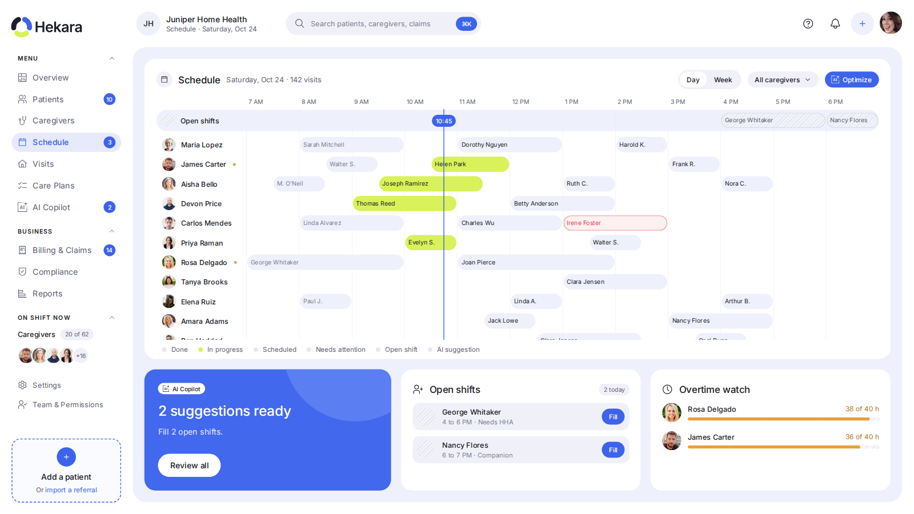
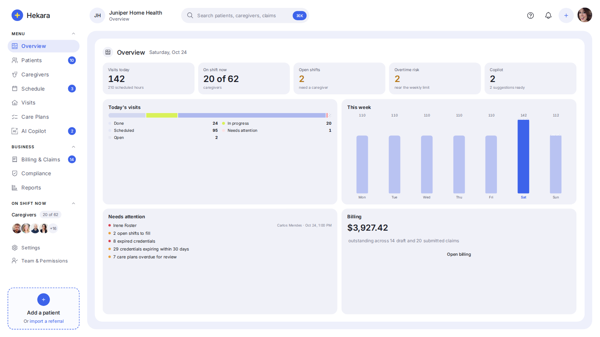
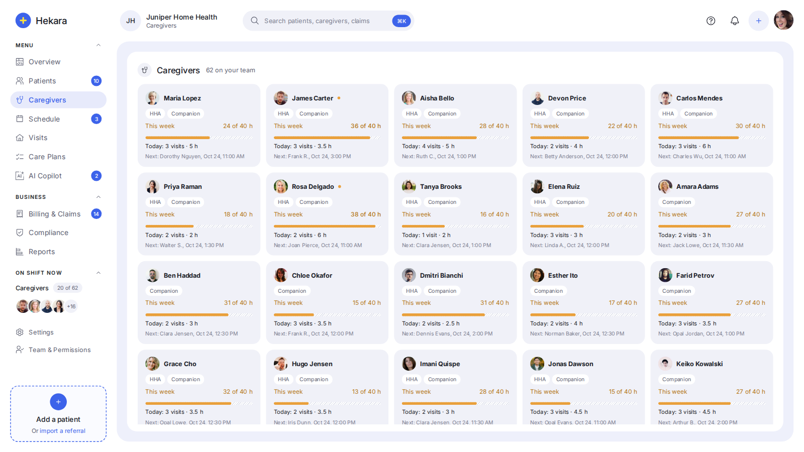
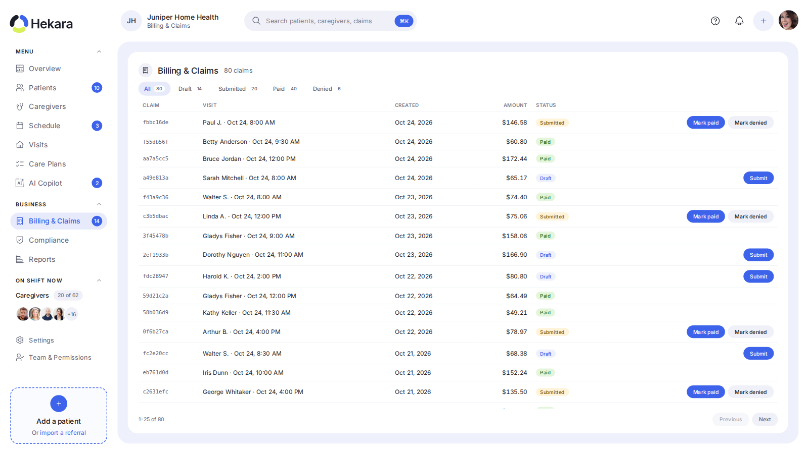
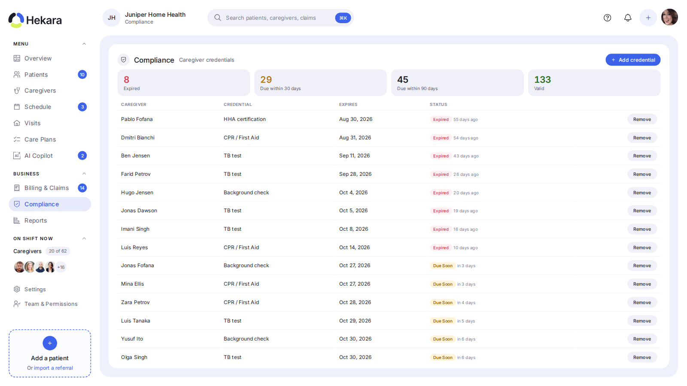
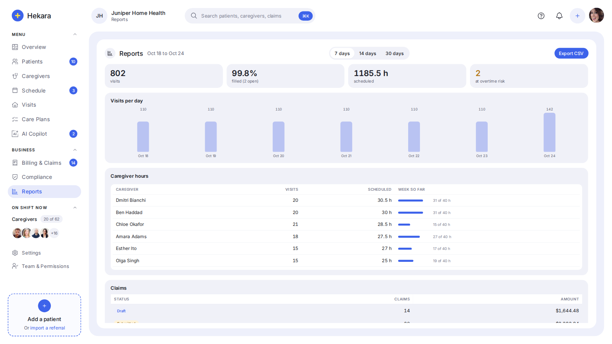
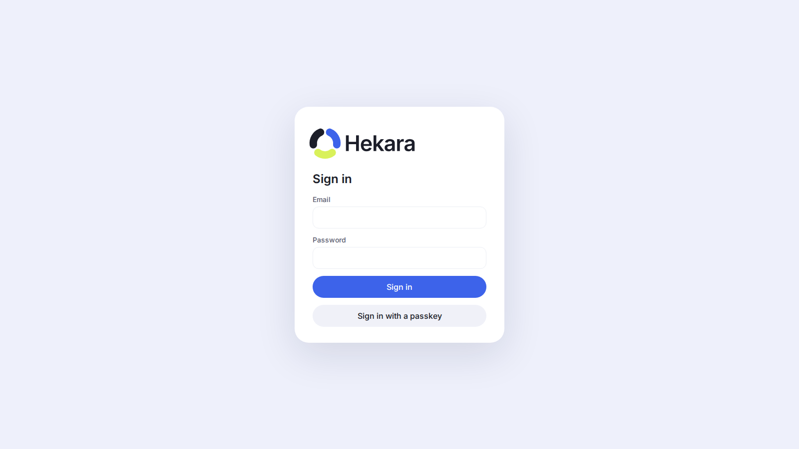
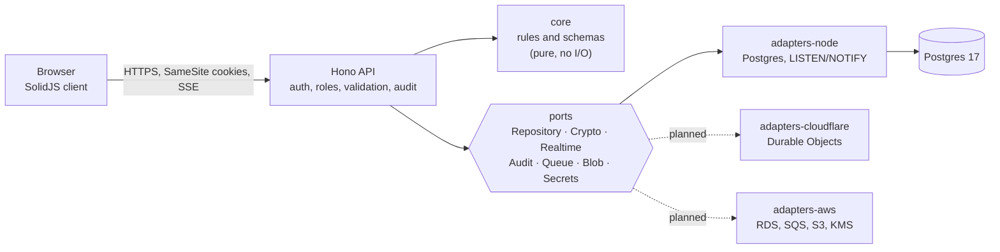

<div align="center">

# Hekara

**Open-source scheduling and operations for home health agencies.**
A live caregiver timeline, one-click open-shift filling, overtime watch, AI-assisted suggestions, care plans, credential tracking, billing and reports, with patient data encrypted field by field and hosting you can move between clouds.

[](LICENSE)
[](https://github.com/Srinivas26k/Hekara/actions/workflows/ci.yml)


[](CONTRIBUTING.md)
[](COMMERCIAL.md)

[Features](#features) · [Quick start](#quick-start) · [Architecture](#architecture) · [Security](#security-and-privacy) · [Docs](#documentation) · [Contribute](#contributing) · [Support & funding](#support-and-funding) · [Enterprise](#enterprise-and-custom-builds)



</div>

> **Status: alpha (v0.1).** Hekara runs end to end on Node and Postgres and is ready to evaluate, contribute to and build on. It has **not** been security-audited or certified, and it has no public hosted service. Read [Security and privacy](#security-and-privacy) before putting real patient data anywhere near it.

## Why Hekara

Home health agencies schedule with spreadsheets or heavy legacy tools. Open shifts are found late, overtime is discovered after payroll, and callouts become phone tag. Hekara puts a day on one live screen, tells you what needs attention, and suggests the fix.

It is built around four ideas:

- **Light.** One small server, a client of about 47 KB gzipped, no Redis and no queue broker. A clinic can run it on a small VPS.
- **Secure by default.** Patient fields are encrypted before they reach the database, every route denies by default, and every access to a record is written to a tamper-evident audit log.
- **Portable.** The app talks to interfaces ("ports"), not to a cloud. Postgres on Node ships today; other platforms are adapters that must pass the same contract tests.
- **Honest.** Behaviour you can read, rules you can explain, and documentation that says what is _not_ done.

## Features

| Area                    | What you get                                                                                                                                                                                  |
| ----------------------- | --------------------------------------------------------------------------------------------------------------------------------------------------------------------------------------------- |
| **Schedule**            | Live day timeline (7 AM to 7 PM) with a moving "now" marker, statuses that follow the clock (done, in progress, scheduled), week view, per-caregiver filter, updates pushed to every open tab |
| **Open shifts**         | One-click **Fill** that picks an eligible caregiver (skill match, no overlap, weekly limit), with **Undo**                                                                                    |
| **Overtime watch**      | Caregivers at 90%+ of their weekly limit, with progress bars                                                                                                                                  |
| **AI Copilot**          | Explainable, rule-based suggestions to fill shifts and avoid overtime. Recomputed on the server when applied, so stale suggestions are rejected. No patient data leaves your server           |
| **Overview**            | Today's visits by status, the week at a glance, an attention list (open shifts, expired credentials, overdue reviews), and a billing snapshot for admins                                      |
| **Visits**              | Day-by-day list with status filters and fill actions                                                                                                                                          |
| **Patients**            | Paged list, full record, add a patient. Names, dates of birth, addresses and notes are encrypted                                                                                              |
| **Care plans**          | Per-patient plans with tasks, instructions, status and review dates, all encrypted                                                                                                            |
| **Caregivers**          | Cards with weekly load, skills, today's visits and next visit                                                                                                                                 |
| **Compliance**          | Credential tracker (CPR, TB test, background check...) bucketed into expired, due in 30 days, due in 90 days and valid                                                                        |
| **Billing & claims**    | Claims by status with a guarded workflow: draft, submitted, paid or denied                                                                                                                    |
| **Reports**             | Hours, fill rate, visits per day and claim totals over 7, 14 or 30 days, plus a CSV export that neutralises spreadsheet formulas                                                              |
| **Accounts & security** | Invite-only accounts, passkeys, authenticator-app codes, four roles, admin activity log with integrity check                                                                                  |

<details>
<summary><b>More screenshots</b></summary>

|                                                |                                           |
| ---------------------------------------------- | ----------------------------------------- |
|           |  |
|  |  |
|             |          |

All screenshots use synthetic demo data. The profile photos are placeholder portraits from [randomuser.me](https://randomuser.me/photos) (hand-picked from the authorised section of [UI Faces](https://uifaces.co)); they are downloaded locally for demos and are **not** part of this repository. In your own deployment people show as initials until a photo is set.
</details>

### Roles

| Role          | Can                                                                                     |
| ------------- | --------------------------------------------------------------------------------------- |
| **Admin**     | Everything, including invites, settings, deleting credentials and the activity log      |
| **Scheduler** | Schedule, visits, patients, care plans, caregivers, credentials, hours and fill reports |
| **Caregiver** | Their own visits only (enforced on the server, not just hidden in the page)             |
| **Billing**   | Claims and claim figures in reports                                                     |

## Quick start

You need **Node 24+**, **pnpm 12**, and **Docker** (for Postgres).

```sh
git clone https://github.com/Srinivas26k/Hekara.git
cd Hekara

cp .env.example .env
pnpm install

pnpm keygen                      # prints two DATA_KEYS lines: paste them into .env
openssl rand -base64 48          # paste the output as AUTH_SECRET in .env

docker compose up -d db          # Postgres on port 5442
pnpm db:migrate
DEMO_PASSWORD='choose-a-long-password' pnpm db:seed
pnpm demo:avatars                # optional: placeholder profile photos for the demo people

pnpm build && pnpm start         # http://localhost:3000
```

Sign in as `admin@juniper.test`, `scheduler@juniper.test`, `caregiver@juniper.test` or `billing@juniper.test` with the password you chose.

In development, add `?at=10:45` to the URL to freeze the clock and see the timeline at a fixed time.

```sh
pnpm typecheck       # strict TypeScript across every package
pnpm test            # unit, contract and integration tests (needs the database from docker compose)
pnpm dev             # server with reload
pnpm dev:client      # Vite dev server for the UI on :5173
```

## Architecture

Hekara follows **ports and adapters**. The domain and HTTP layers know nothing about where they run; platforms plug in through adapters, and every adapter must pass one shared contract test suite.



```text
apps/web                 Hono API + SolidJS client (one deployable)
packages/core            Domain types, Valibot schemas, scheduling and compliance rules (pure)
packages/ports           Interfaces every platform adapter implements
packages/crypto          AES-256-GCM field encryption, key rotation, blind indexes
packages/db              Drizzle schema and SQL migrations
packages/adapters-node   Postgres repository, hash-chained audit, LISTEN/NOTIFY realtime, Argon2id
packages/contract-tests  The suite every adapter must pass
docs/                    PRD, TRD, architecture, security, HIPAA notes, portability, ADRs
```

### Tech stack

| Layer      | Choice                                                                                                               |
| ---------- | -------------------------------------------------------------------------------------------------------------------- |
| Language   | TypeScript 7 (strict), end to end, shared types and schemas                                                          |
| API        | [Hono](https://hono.dev), runtime-agnostic (Node today; Workers, Lambda and Cloud Run are possible through adapters) |
| Client     | [SolidJS](https://www.solidjs.com) + Vite, hand-written CSS, self-hosted fonts                                       |
| Data       | PostgreSQL 17 with [Drizzle ORM](https://orm.drizzle.team)                                                           |
| Validation | [Valibot](https://valibot.dev) on every route, shared with the client                                                |
| Auth       | [Better Auth](https://www.better-auth.com): passkeys, TOTP, Argon2id passwords, invite-only                          |
| Crypto     | WebCrypto AES-256-GCM, HKDF per-agency keys, versioned envelope `v1.<keyId>.<iv>.<ct>`                               |
| Tests      | Vitest: unit, shared adapter contract suite, and API integration tests                                               |

## Security and privacy

What is built and tested today:

- **Field-level encryption** of patient names, dates of birth, addresses, notes, visit labels and care plans, with per-agency keys and rotation. Searching uses HMAC blind indexes, so plaintext is never indexed.
- **Tenant isolation:** every repository query is scoped by agency, and tests prove one agency cannot read, change or even detect another's data.
- **Deny-by-default roles**, checked on the server for every route.
- **Sessions:** 30 minutes idle, 12 hours absolute, `HttpOnly` `SameSite=Strict` cookies, exact-`Origin` checks on every write.
- **Sign-in protection:** Argon2id, per-address rate limits, and a per-account lockout that attackers cannot dodge by changing address. Failures return one uniform message.
- **Audit log:** append-only and hash-chained, with an admin integrity check and a daily verification job. Entries record who did what, never the patient data itself.
- **Browser hardening:** strict same-origin CSP with no inline script, no third-party requests, bundled fonts, and generated avatars.

What is **not** true yet, said plainly:

- Hekara has **not** had an independent security review or penetration test.
- Passkey sign-in is wired up but not covered by an automated test.
- Rate limiting and lockout are in memory, per server instance.
- There is no email service yet, so invite links are handed over by an admin.

### HIPAA and certifications

Software cannot be "HIPAA compliant" by itself. Compliance is a property of how an organisation operates: signed Business Associate Agreements with every vendor that touches patient data, risk assessments, policies, training and breach procedures. Hekara provides the technical safeguards (encryption, access control, audit trails, integrity checks) and [maps them to the rules](docs/HIPAA.md), but **Hekara itself holds no HIPAA, SOC 2, HITRUST or ISO 27001 certification.** If you need a deployment that supports those programmes, see [Enterprise and custom builds](#enterprise-and-custom-builds).

## Documentation

| Document                                     | What it covers                                                          |
| -------------------------------------------- | ----------------------------------------------------------------------- |
| [docs/PRD.md](docs/PRD.md)                   | Users, goals, features, success metrics                                 |
| [docs/TRD.md](docs/TRD.md)                   | Stack, data model, API, encryption format, performance budgets          |
| [docs/ARCHITECTURE.md](docs/ARCHITECTURE.md) | Ports and adapters, package rules, request flow                         |
| [docs/SECURITY.md](docs/SECURITY.md)         | Threat model, encryption, auth, hardening and known limits              |
| [docs/HIPAA.md](docs/HIPAA.md)               | Safeguards the code provides and what stays organisational              |
| [docs/PORTABILITY.md](docs/PORTABILITY.md)   | Moving between Cloudflare, AWS, GCP, Azure, Kubernetes and self-hosting |
| [docs/DEPLOYMENT.md](docs/DEPLOYMENT.md)     | From a small clinic to an enterprise                                    |
| [docs/DECISIONS.md](docs/DECISIONS.md)       | Architecture decision records                                           |
| [docs/ROADMAP.md](docs/ROADMAP.md)           | What is done and what is next                                           |
| [AGENTS.md](AGENTS.md)                       | Rules for AI coding agents working in this repo                         |

## Roadmap

Done: live schedule, every page above, sign-in with roles, field encryption, audit log, contract-tested Postgres adapter.

Next: creating claims from completed visits, a Cloudflare adapter and the portable export/import tooling, a phone layout, shared-store rate limiting for multi-instance setups, and a plaintext-PHI scan of storage and logs as an automated test. See [docs/ROADMAP.md](docs/ROADMAP.md).

## Contributing

Contributions are welcome: bug reports, documentation fixes, tests, new adapters, translations and features. Start with [CONTRIBUTING.md](CONTRIBUTING.md), look for issues labelled [`good first issue`](https://github.com/Srinivas26k/Hekara/labels/good%20first%20issue) or [`help wanted`](https://github.com/Srinivas26k/Hekara/labels/help%20wanted), and say hello in [Discussions](https://github.com/Srinivas26k/Hekara/discussions). Please read the [Code of Conduct](CODE_OF_CONDUCT.md).

Found a vulnerability? Please **don't** open a public issue. See [SECURITY.md](SECURITY.md).

## Support and funding

Hekara is free and open source. There are several ways to get help or help it grow:

- **Community help:** ask in [Discussions](https://github.com/Srinivas26k/Hekara/discussions) or open an [issue](https://github.com/Srinivas26k/Hekara/issues). See [SUPPORT.md](SUPPORT.md).
- **Paid support and consulting:** setup, hosting, migration, training and priority fixes are available. Email **[srinivasvarma764@gmail.com](mailto:srinivasvarma764@gmail.com)**.
- **Sponsorship and donations:** funding keeps the project maintained, audited and documented. A sponsorship page is being set up; until it is live, write to the email above to sponsor a feature, fund a security review, or make a donation.
- **Star and share:** a star on GitHub helps other agencies and developers find it.

## Enterprise and custom builds

Need Hekara adapted to your organisation? I build and support custom deployments for agencies and health-tech teams, including:

- **HIPAA-oriented deployments:** BAA-ready hosting design, encryption and key management, audit and access reviews, breach-response tooling.
- **SOC 2 and other frameworks:** readiness work, control mapping and evidence collection for SOC 2, HITRUST and ISO 27001 programmes. (Certifications are earned by your organisation through an independent auditor; I help you prepare for and support them.)
- **Integrations and features:** SSO (SAML/OIDC), EHR and payroll integrations, claim export formats, custom reports and workflows.
- **Hosting and migration:** Cloudflare, AWS, GCP, Azure, Kubernetes or on-premises, including moves between platforms.
- **Commercial licensing:** if the AGPL does not fit your product, a commercial licence is available.

Details are in [COMMERCIAL.md](COMMERCIAL.md). Contact: **[srinivasvarma764@gmail.com](mailto:srinivasvarma764@gmail.com)**.

## License

Hekara is licensed under the **[GNU Affero General Public License v3.0](LICENSE)**. In short: you can use, study, modify and share it freely; if you offer a modified version as a network service, you must make your changes available under the same licence. A commercial licence is available for those who need different terms ([COMMERCIAL.md](COMMERCIAL.md)).

## Acknowledgements

Icons are from IBM's [Carbon Design System](https://carbondesignsystem.com/elements/icons/library/) (Apache-2.0). Built on the shoulders of [Hono](https://hono.dev), [SolidJS](https://www.solidjs.com), [Drizzle](https://orm.drizzle.team), [Better Auth](https://www.better-auth.com), [Valibot](https://valibot.dev), [Vite](https://vite.dev) and [PostgreSQL](https://www.postgresql.org). Created and maintained by [Nampalli Srinivas](https://github.com/Srinivas26k).
