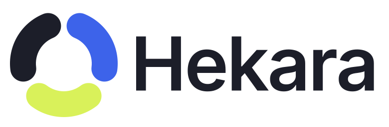

# Hekara brand

The mark is **Round the clock**: three rounded arcs, one for each 8-hour shift, closing into a ring. Care that never stops, handed from one shift to the next.

<picture>
  <source media="(prefers-color-scheme: dark)" srcset="logo-horizontal-reversed.svg">
  
</picture>

## Files

| File                                                                               | Use                                                                                             |
| ---------------------------------------------------------------------------------- | ----------------------------------------------------------------------------------------------- |
| `logo-horizontal.svg`                                                              | Primary logo, on light backgrounds                                                              |
| `logo-horizontal-reversed.svg`                                                     | Primary logo on dark backgrounds                                                                |
| `logo-stacked.svg`, `logo-stacked-reversed.svg`                                    | Square-ish spaces, posters, slides                                                              |
| `logo-symbol.svg`, `logo-symbol-reversed.svg`                                      | The mark alone, when the name appears nearby                                                    |
| `logo-*-black.svg`, `logo-*-white.svg`                                             | One-colour versions: print, stamps, embroidery, fax-style output                                |
| `app-icon.svg`, `png/icon-192.png`, `png/icon-512.png`, `png/apple-touch-icon.png` | App and home-screen icons                                                                       |
| `favicon.svg`, `png/favicon.ico`, `png/favicon-16.png` ...                         | Browser tab. A bolder cut of the mark that holds up at 16 px                                    |
| `build_logo.py`                                                                    | Regenerates every file above from geometry (needs `fonttools` and the Inter SemiBold font file) |

All SVGs are pure shapes: the wordmark is converted to outlines, so no font is needed to display them.

## Colour

| Name        | Hex       | RGB           | Role                                        |
| ----------- | --------- | ------------- | ------------------------------------------- |
| Hekara Blue | `#3D63EA` | 61, 99, 234   | Brand colour, buttons, links                |
| Shift Lime  | `#D9F15A` | 217, 241, 90  | Accent, "in progress"                       |
| Deep Ink    | `#1C1E29` | 28, 30, 41    | Text and the third arc                      |
| White       | `#FFFFFF` | 255, 255, 255 | Backgrounds and the third arc when reversed |

Lime is a shape colour only. **Never set text in lime on white**: it fails contrast. Print values (CMYK, Pantone) should be matched by your printer from the hex above and checked on a proof.

## Using the logo

- **Clear space:** keep at least the width of one arc (about 20% of the symbol's height) free on every side.
- **Minimum size:** the horizontal logo no smaller than 96 px wide on screen (25 mm in print); the symbol no smaller than 24 px. Below that, use the favicon cut (`favicon.svg`).
- **Backgrounds:** use the colour logo on white or very light backgrounds and the reversed logo on dark ones. On busy images or colours, use the one-colour black or white version.
- **Do not:** recolour the arcs, change their order or spacing, rotate or stretch the logo, add shadows or outlines, set the name in another typeface, or put the colour logo on a mid-tone that makes the blue or lime disappear.

## Type

The wordmark is **Inter SemiBold** (SIL Open Font License 1.1) at -2.7% tracking, converted to outlines. The product UI also uses Inter, bundled with the app.

## The name and the logo

The Hekara software is open source under the AGPL-3.0, but the **Hekara name and logo are not part of that licence**. You are welcome to say your product is built on Hekara or compatible with it. Please do not use the name or logo in a way that suggests your product is the official Hekara or is endorsed by the project. Forks should use their own name and mark. For permission questions, see [COMMERCIAL.md](../COMMERCIAL.md).
